<div align="center">

# Alson Garbuja

**Full-stack engineer · Game dev**

`▶ PRESS START` &nbsp;·&nbsp; Ship · Learn · Repeat

</div>

<br/>

## `player_one`

```yaml
name:             Alson Garbuja
class:            Full-stack engineer / Game developer
current_location: Cape Girardeau, MO, USA
guilds:           [Folktales Gaming, Thanka Digital]
current_quest:    Small, useful work over vague claims
```

<br/>

## `inventory`

<p>
  
  
  
  
  
  
  
  
</p>

<br/>

## `active_quests`

| Quest | Type | Status |
| :-- | :-- | :-- |
| [**beej-monorepo**](https://github.com/Thanka-Digital/beej-monorepo)<br/><sub>Packages, docs and design systems</sub> | `TypeScript` | ⚔️ In progress |
| [**unmark**](https://github.com/alsongarbuja/unmark)<br/><sub>Chrome extension that reminds you to clear piled-up bookmarks</sub> | `TypeScript` | ⚔️ In progress |
| [**LLD**](https://github.com/alsongarbuja/LLD)<br/><sub>Static website documenting my journey to cracking interviews: LeetCode solutions, system design patterns, DSA and more</sub> | `Docs` | 📚 Side quest |
| [**Manjushree: The Legend of Kathmandu**](https://github.com/folktalesgaming/MANJUSHREE_THE_LEGEND_OF_KATHMANDU)<br/><sub>Story-driven semi-open game inspired by Nepali legend</sub> | `Game` | 🎮 Side quest |
| [**cloud-based-ai-resume-screening**](https://github.com/alsongarbuja/cloud-based-ai-resume-screening)<br/><sub>AI resume screening and job matching on the cloud</sub> | `TypeScript` | 🧪 Grad project |

<br/>

## `why_games`

<p align="center">
  
</p>

<p align="center"><sub><code>input → update → render → repeat</code></sub></p>

<br/>

## `activity_log`

<p align="center">
  
</p>

<br/>

## `multiplayer`

Open to collabs, co-op projects and good conversations.

[**Website**](https://alsongarbuja.com.np) &nbsp;·&nbsp; [**LinkedIn**](https://linkedin.com/in/alsongarbuja)

<br/>

<div align="center">
  <sub><code>GAME NOT OVER</code> · keep shipping 🕹️</sub>
</div>
